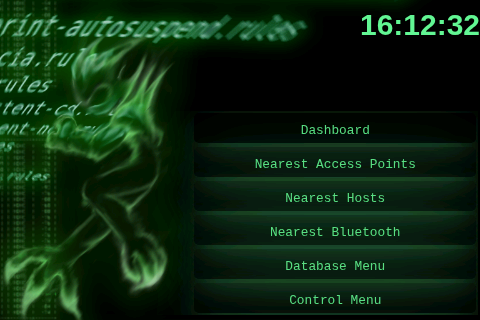
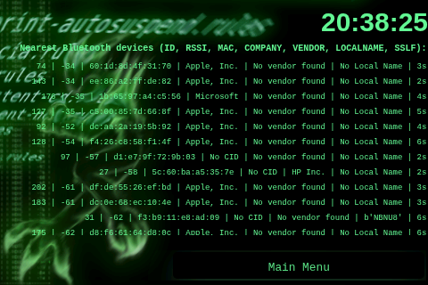

<div align="center">

# Skipskap

<div>
    
</div>

[](https://opensource.org/licenses/MIT)

<p>A series of scripts that creates a Wardriving frontend and backend experience on Raspberry Pi.</p>

<div>
    
    <br>
    <em>Main menu</em>
</div>
<div>
    
    <br>
    <em>Bluetooth dashboard</em>
</div>

</div>

## What is included:

### Interface
  - Powered by Electron React Boilerplate
  - Provides a legible dashboard displaying nearby wireless devices
  - Provides basic controls of the wardriver including:
    - Database controls
    - Hotspot toggling
      - Creates an access point hosting the node-graph at 10.22.10.1:blahIforget
    - Scanner toggling

### Node-Graph
  - Powered by a React Flow
  - Provides a node graph of all scanned devices
    - Access points and hosts are in green text
    - Bluetooth devices are in blue text

## Internals:

### Python Scripts
  - Most functionaility comes from the use of Python scripts:
    - ``ScanScript.py``: 802.11 Frame scanner script
      - Scans for probe and beacon frames
      - Sends all logged information to the local database 

    - ``BTScanScript.py``: Bluetooth scanner script
      - Scans for nearby bluetooth advertisements
      - Sends all logged information to the local database 
      - ***WORK IN PROGESS***: Apple products wind up being scanned disproportionately compared to all other devices.

    - ``PackStorm.py``: Deauthentication script
      - ***WORK IN PROGRESS***: A script that will be used that will attempt deauthtenication attacks.
        - Will be used by the either the node-graph, user interface, or both in the future

    - ``Endpoints.py``: Backend API for the local database 
      - Used by all components of the project:
        - Interface: Real-time display of information stored in the database
        - Node-Graph: Display of information stored in the database in a structured format with hosts under their respective access points
        - Scanner scripts: Use this API to log all scanned entries into the database

    - ``ControlPanel.py``: Websocket API for the control panel
      - Used by the interface to control and toggle internal functions such as:
        - Hotspot 
        - Node-Graph
        - Killing all running Skipskap processes

### Shell Scripts
  - Shell scripts primarily ran by the python scripts in order to set things on the system level 
    - ``BTInit.sh``: Starts the ``BTScanScript.py`` Python script within the correct virtual environment
    - ``DisplayInit.sh``: Runs the main user interface 
    - ``ExportDB.sh``: ***WORK IN PROCESS*** Exports a database via netcat to the IP and port of a machine connected to the hotspot
    - ``Init.sh``: The main initiation script. Starts all essential processes along with ``DisplayInit.sh``
    - ``KillProcs.sh``: Kills all running Skipskap processes
    - ``MonitorInit.sh``: Turns off NetworkManager, switches the interface to monitor mode, then turns Network Manager back on
    - ``NodeInit.sh``: Turns on the node graph 
    - ``OffIface.sh``: Turns off the scanner interface so the wireless adapter stops blinking 
    - ``UplinkInit.sh``: Turns off NetworkManager, switches the interface to managed mode, then turns Network Manager back on

## Setup 

First create a virtual environment in the Python, activate and download dependencies through requirements.txt:

```sh
cd Python
python3 -m venv venv
source venv/bin/activate
pip install -r requirements.txt
```

Then create the database schema:
```sh
cd CreationScripts
./CreateDBSchema.sh
```
If it asks for a password, enter ``skap``

Finally, run the initiation script as root and wait for everything to bootup:
```sh
cd Shell
./Init.sh
```
